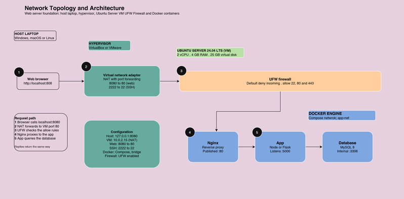

# Laboratory 10: The Enterprise Cloud Architect

- **Course:** CCM101 – Cloud Computing
- **Student:** Jonas E. Baldoz
- **Institution:** University of Eastern Pangasinan, College of Information Technology
- **Client scenario:** CloudNova Technologies (CEO: Cledmar Badongen)

## Overview

This project is a secure, automated, multi-tier private cloud environment built for the final mission. It deploys a **WordPress + MariaDB** stack using Docker Compose (Infrastructure as Code), hardened with UFW, and protected by an automated database backup script scheduled through cron.

## Chosen Stack

| Tier | Technology | Purpose |
|------|------------|---------|
| Web / Application | WordPress (Apache + PHP) | Content management application |
| Database | MariaDB 11 | Persistent data storage |
| Orchestration | Docker Compose | Defines and links the containers |
| Host OS | Ubuntu Server (Linux VM) | Base operating system |
| Firewall | UFW | Host-based security, default deny |
| Automation | Bash + Cron | Daily database backups |

## Architecture



**Flow:** Host Laptop → Hypervisor → Ubuntu Server VM → UFW Firewall → Docker Network → WordPress + MariaDB → Persistent Volumes

## Repository Contents

| File | Description |
|------|-------------|
| [README.md](README.md) | Project overview (this file) |
| [architecture-diagram.png](architecture-diagram.png) | Network topology and architecture diagram |
| [docker-compose.yml](docker-compose.yml) | Infrastructure as Code for the two-tier stack |
| [automation-script.sh](automation-script.sh) | Bash script that backs up the MariaDB database |
| [operational-manual.md](operational-manual.md) | Deploy, secure, and maintain guide for the client IT team |
| [final-reflection.md](final-reflection.md) | Reflection on Missions 1 to 10 |
| [.env.example](.env.example) | Template for credentials (the real `.env` is not committed) |
| [.gitignore](.gitignore) | Keeps `.env` and backups out of Git |

## Requirements Checklist

- [ ] **Requirement 1:** Architecture diagram, VM provisioned, Ubuntu Server installed, browser access from host
- [ ] **Requirement 2:** Docker and Docker Compose installed, multi-container stack, persistent volumes
- [ ] **Requirement 3:** UFW enabled, default deny, only SSH and application ports allowed
- [ ] **Requirement 4:** Executable Bash script and cron job configured
- [ ] **Requirement 5:** Operational manual, raw code committed, final reflection

## Quick Start

```bash
# 1. Create the environment file (use your own strong passwords)
cp .env.example .env

# 2. Start the stack
docker compose up -d

# 3. Verify both containers are running
docker compose ps

# 4. Open in browser
# http://<server-ip>:8080
```

## Security Summary

- UFW enabled with **default deny incoming**
- Only SSH (22/tcp) and WordPress (8080/tcp) are allowed
- The database container has no published ports and is reachable only on the internal Docker network
- Credentials are stored in `.env`, which is excluded from Git through `.gitignore`
- Docker publishes ports through iptables and can bypass UFW, so only the one required port is published

## Automation Summary

`automation-script.sh` creates a compressed dump of all databases, saves it to `backups/`, and deletes backups older than 7 days. Cron runs it daily at 2:00 AM.

```bash
chmod +x automation-script.sh
crontab -e
# add this line:
0 2 * * * /full/path/to/automation-script.sh
```

See [operational-manual.md](operational-manual.md) for the restore procedure.

## Environment Note

The Docker stack, firewall, and automation were tested on a Killercoda Ubuntu sandbox. The hypervisor and Ubuntu Server VM design is shown in `architecture-diagram.png`.

## AI Usage Disclosure

I used an AI assistant (Claude) to help brainstorm the project structure and clarify commands. I reviewed, tested, and can explain each configuration, and the final reflection is written in my own words.
